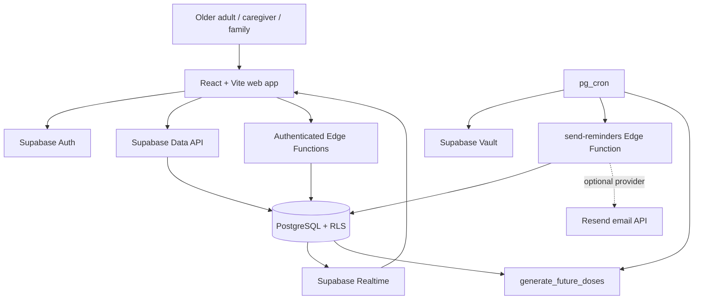
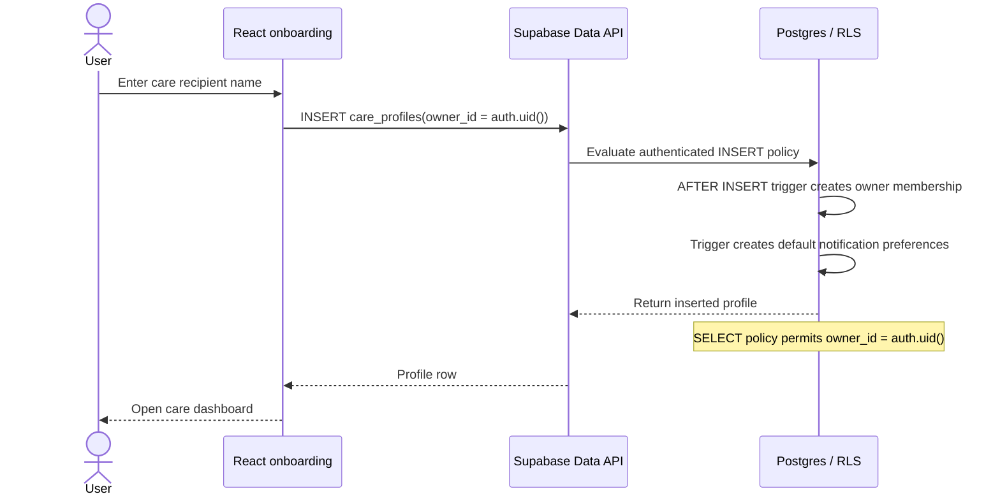

# Everkind architecture

## System context

Everkind is a browser-based collaborative care workspace. The browser is an untrusted client: identity comes from Supabase Auth, data access is constrained by PostgreSQL Row Level Security (RLS), and privileged membership/invitation operations run in Edge Functions.

## Runtime components

| Component        | Responsibility                                                                                   | Trust boundary                    |
| ---------------- | ------------------------------------------------------------------------------------------------ | --------------------------------- |
| React 18 + Vite  | Authentication UI, onboarding, dashboard, medications, appointments, care circle and preferences | Untrusted browser                 |
| Supabase Auth    | Password authentication and JWT issuance                                                         | Identity provider                 |
| Postgres         | Authoritative care records, constraints, triggers, audit events and scheduling                   | Data authority                    |
| RLS              | Enforces profile membership and role checks for every browser data request                       | Primary data authorization        |
| Edge Functions   | Create/redeem invitations, revoke members and process reminders                                  | Server-side privileged operations |
| pg_cron + pg_net | Schedule dose generation and optional reminder delivery                                          | Database scheduler                |
| Vault            | Stores scheduler credentials and server-only configuration                                       | Secret storage                    |
| Vercel           | Hosts the public web frontend                                                                    | Static frontend hosting           |
| Docker + Nginx   | Reproducible static container and health endpoint                                                | Optional deployment target        |

## Data model

- `care_profiles`: care recipient display name, immutable owner and IANA timezone.
- `care_members`: profile-to-user membership, role and active/revoked state.
- `care_invites`: hashed one-time invitation, optional invited email, role, expiry and redemption timestamp.
- `medications`: medicine metadata, prescribed dosage text, instructions, schedule and active date range.
- `medication_doses`: one row per scheduled dose instant, outcome, recording user and note.
- `appointments`: clinician, specialty, start instant, location, notes and status.
- `notification_preferences`: per-profile email and lead-time preferences.
- `notification_deliveries`: deduplication key and delivery outcome.
- `audit_events`: actor, action, entity and timestamp for care-plan changes.

## Profile creation sequence

The owner SELECT policy is important because PostgREST's insert-and-return flow must be able to see the inserted row. The live rollback-only RLS verification exercises this path using the authenticated database role and confirms the owner can read the inserted row without leaving test data behind.

## Authorization model

- All nine public application tables have RLS enabled.
- Anonymous users have no application-table data access.
- Profile INSERT requires `owner_id = auth.uid()`.
- Profile ownership cannot be changed after creation.
- Active membership is required to read a care profile and its associated records.
- Care managers are owner, care recipient and caregiver roles.
- Family role is read-oriented; dose outcome writes are separately constrained to an active member and the authenticated recorder.
- Membership changes and invitation records are not directly writable/readable by browser roles; server-side functions perform these operations.
- Dose identity, scheduled time and creation time are protected from client updates.
- Reminder-secret validation is executable only by the service role.

See [Security model](SECURITY.md) and `supabase/tests/security_smoke.sql`.

## Scheduling and timezone model

Each profile has an IANA timezone. The dose generator derives the current calendar date with `(now() AT TIME ZONE profile.timezone)::date`, then generates the rolling 14-day window from that date. Due times are converted from profile-local date/time to `timestamptz`. A unique constraint on `(medication_id, due_at)` makes generation idempotent.

The scheduler uses profile timezone rather than the database server's UTC `current_date`, avoiding a one-day boundary error around midnight in zones ahead of or behind UTC.

## Performance choices

- Initial workspace queries are concurrent where dependencies allow.
- Dose queries are scoped through the active profile's medication IDs.
- Realtime events are ignored unless they concern active-profile medication records.
- Realtime bursts are debounced before reloading.
- Reminder candidate reads, preference reads and membership reads are batched.
- Unique recipient lookups are cached within a reminder invocation.
- Delivery rows are reconciled in batches.
- Foreign-key indexes are retained even if the low-volume development project reports them as unused.

## Failure and recovery

- The database is the source of truth; realtime is an optimization, not a persistence layer.
- Dose generation uses conflict-safe inserts and can be run again safely.
- Invitation redemption claims the invitation atomically and restores the claim if membership creation fails.
- Reminder delivery is optional and disabled until the email provider is configured.
- Never bypass RLS to recover from an application error. Inspect Auth, Postgres and Edge Function logs and correct the policy or authenticated request.
